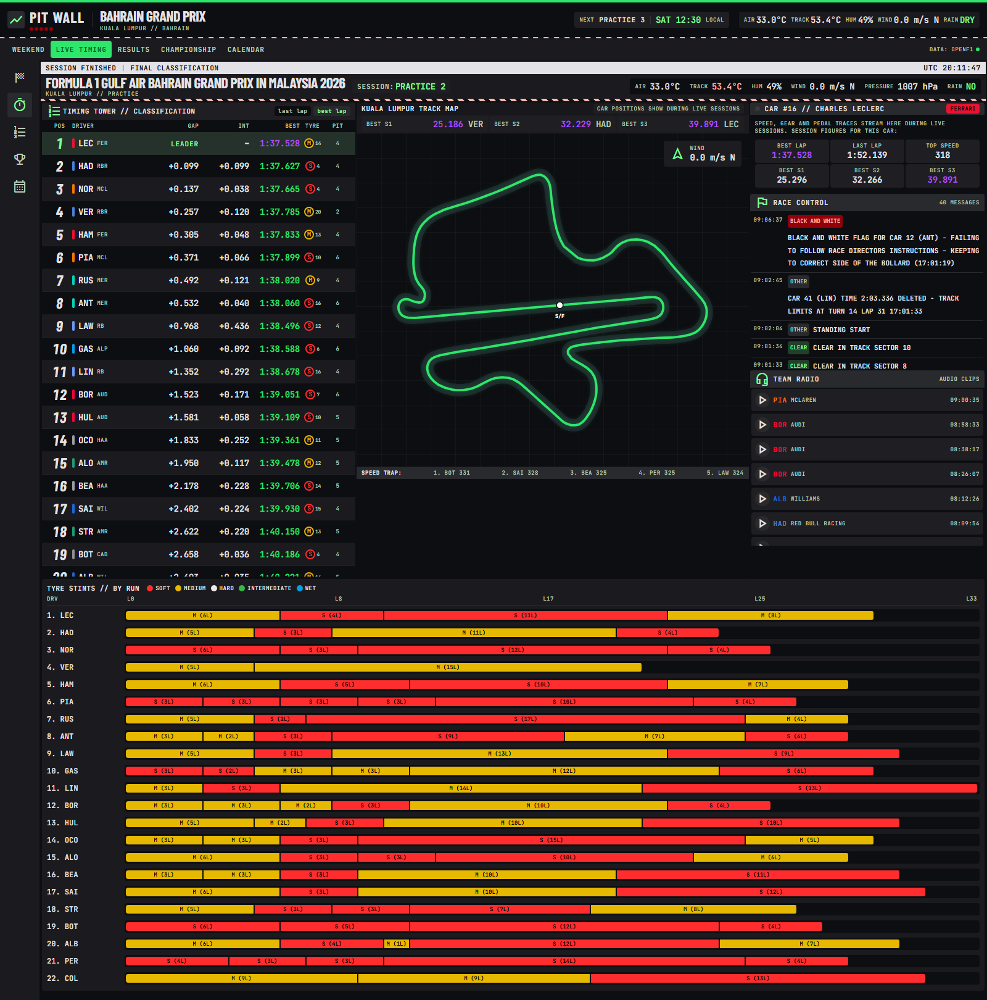
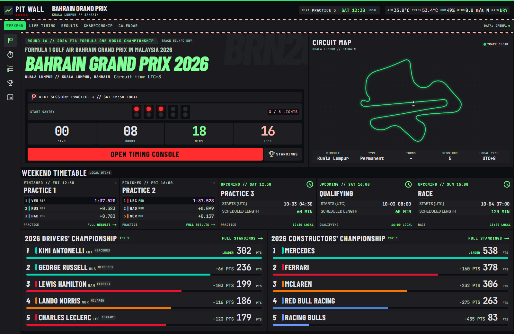
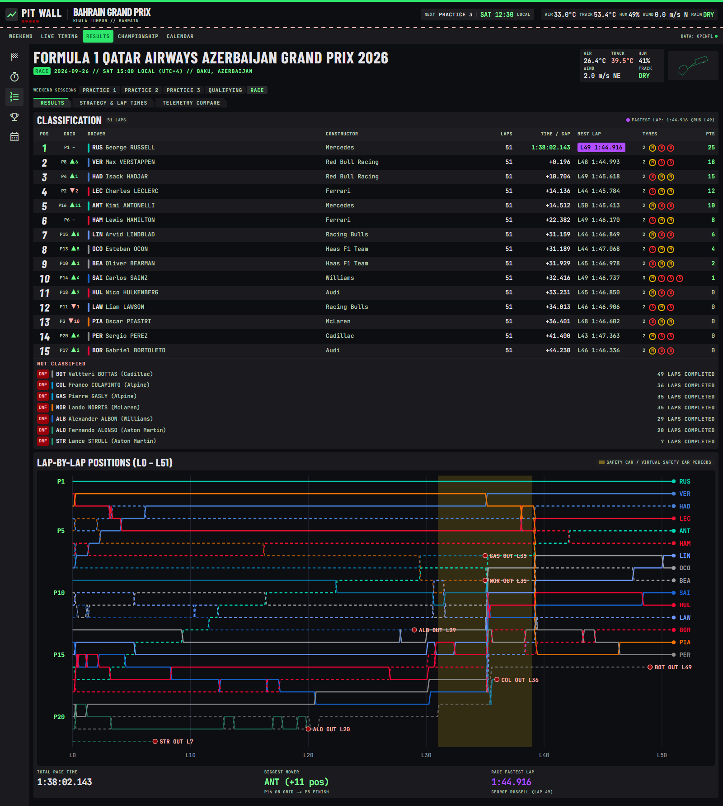
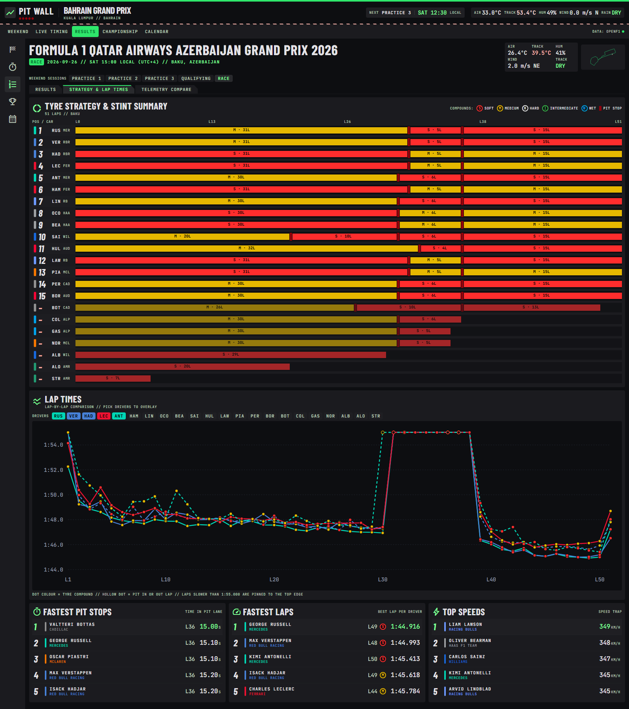
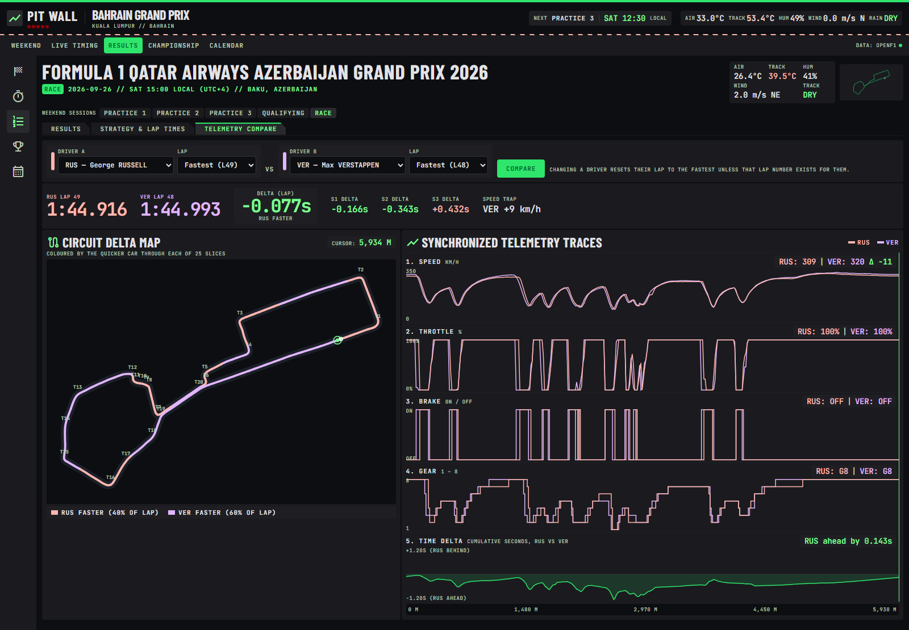
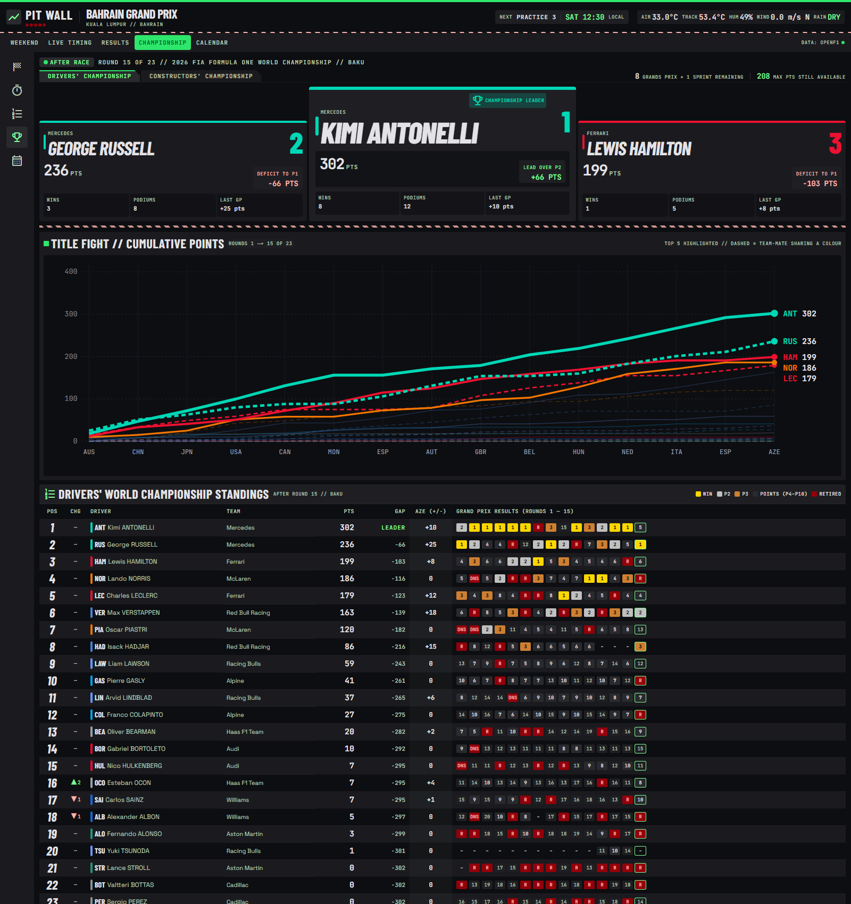
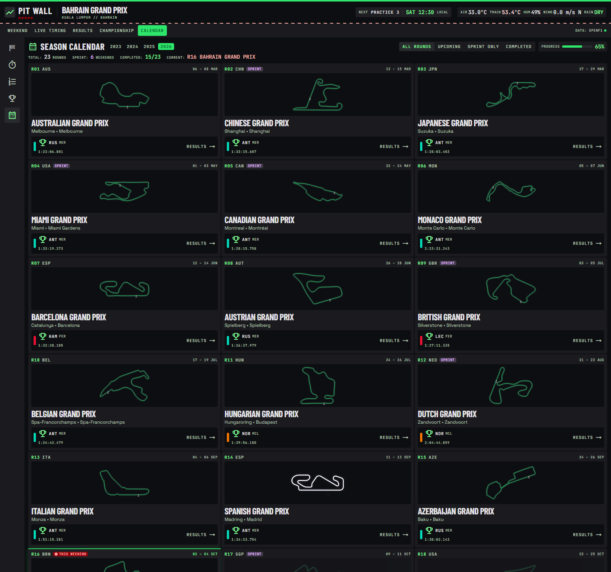

# Pit Wall

An unofficial Formula 1 timing and data site built on the [OpenF1 API](https://openf1.org). It is styled as a race engineer's console: live timing on race weekends, plus results, strategy, telemetry and championship standings for every session since 2023.



> Not affiliated with Formula 1, the FIA or any team. Data comes from OpenF1, which is licensed [CC BY-NC-SA 4.0](https://creativecommons.org/licenses/by-nc-sa/4.0/) for non-commercial use.

## Screens

| Screen | Route | What it shows |
|---|---|---|
| Weekend | `/` | Current grand prix, countdown to the next session, circuit map, session timetable, top five in both championships |
| Live timing | `/live` | Timing tower, track map with car positions, selected-car telemetry, race control, team radio, tyre stints |
| Results | `/session/[key]` | Classification, grid changes, best laps, tyres, lap-by-lap position chart |
| Strategy | `/session/[key]/strategy` | Tyre stints and pit stops per driver, lap-time chart, fastest stops, laps and top speeds |
| Telemetry | `/session/[key]/telemetry` | Two drivers on any lap: speed, throttle, brake, gear and time delta, with a circuit map of who was faster where |
| Championship | `/championship` | Drivers' and constructors' standings, cumulative points chart, results per round |
| Calendar | `/calendar` | Every round of a season with circuit outline, winner or countdown |

`/session/latest` opens the most recent finished session.

### Weekend



### Results



### Strategy and lap times



### Telemetry compare



### Championship



### Calendar



## Getting started

Requires Node.js 20 or newer.

```bash
npm install
npm run dev
```

Open http://localhost:3000. No API key is needed for historical data.

### Live data

OpenF1 serves live data (from 30 minutes before a session to 30 minutes after) only to sponsor accounts, and locks the free API for everyone else during that window. To stream live sessions:

1. Subscribe at [openf1.org](https://openf1.org).
2. Copy `.env.example` to `.env` and set `OPENF1_USERNAME` and `OPENF1_PASSWORD`.
3. Restart the server.

Without credentials the site still works outside live windows. During one, the live screen says the feed is locked and other pages serve their last cached data.

## How it works

- **Framework:** Next.js (App Router), React, TypeScript, Tailwind CSS.
- **API client:** every OpenF1 request goes through `src/lib/openf1/client.ts` on the server. It throttles to the API's rate limit (3 requests a second and 30 a minute on the free tier), caches responses in memory, and serves stale data if the API is unavailable. The browser never calls OpenF1.
- **Live stream:** `src/lib/live/hub.ts` holds one MQTT connection to OpenF1 for the whole server process. `/api/live` fans it out to browsers as Server-Sent Events, batching car positions and sending telemetry only for the selected car.
- **One reducer:** `src/lib/live/state.ts` folds OpenF1 messages into timing state. The server replays REST data through it to build the initial snapshot, and the browser applies stream messages with the same function.
- **Circuit maps:** outlines come from the circuit description linked by each OpenF1 meeting, falling back to the fastest lap's location samples.
- **Telemetry:** OpenF1 has no distance channel, so `src/lib/openf1/telemetry.ts` integrates speed over time and resamples both laps onto a shared distance axis.

### Project layout

```
src/app/            routes (pages and the /api/live stream)
src/components/     UI, grouped by screen
src/lib/openf1/     API client, queries and data shaping
src/lib/live/       live state reducer, snapshot loader, MQTT hub
docs/screenshots/   screenshots used in this README
```

## Deployment

Live timing needs a long-running Node server (`npm run build && npm start`), because the MQTT connection lives in the server process. Serverless platforms that freeze between requests will serve the historical pages but not the live stream.

## Known limitations

- The live streaming path has not been tested against a real session yet.
- On the free tier, a cold visit to several pages in a row can hit the 30-requests-a-minute limit and take up to a minute; repeat visits are served from cache.
- The cache is in memory, so it is lost on restart and not shared between instances.
- OpenF1 covers the 2023 season onwards and does not provide lap length, race distance, tyre temperatures or radio transcripts.

## Licence

The code is released under the [MIT License](LICENSE). That covers this repository's code only: the data it displays belongs to OpenF1 and remains under CC BY-NC-SA 4.0, so any deployment must stay non-commercial.

## Credits

- Data: [OpenF1](https://openf1.org)
- Circuit outlines: [MultiViewer](https://multiviewer.app) circuit descriptions, via OpenF1
- Screen designs: generated with [Google Stitch](https://stitch.withgoogle.com)
